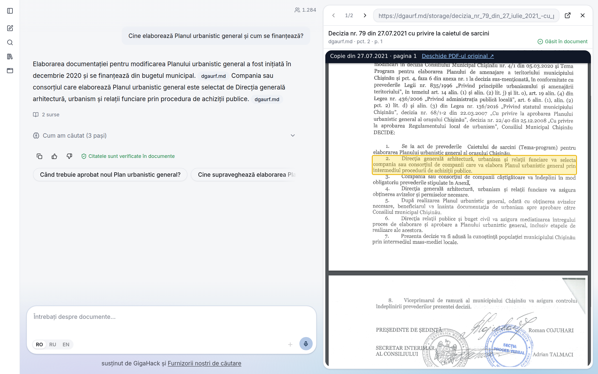
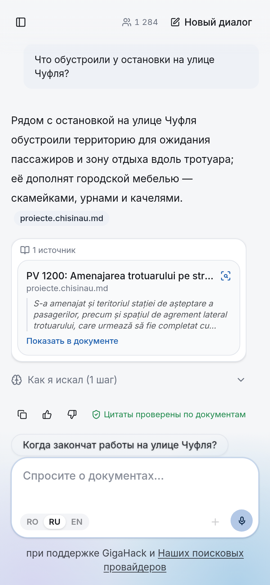
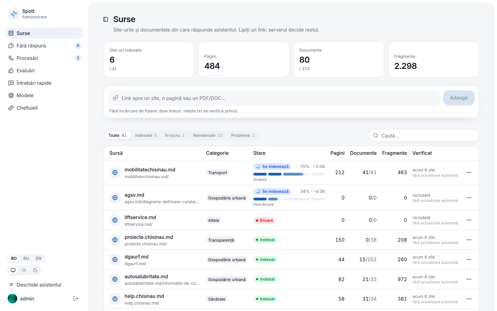
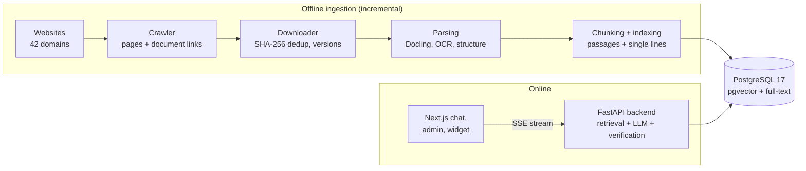

# Spott: AI Document Assistant with Verified Citations

**An end-to-end RAG system that answers questions from large collections of official documents (including scanned PDFs) in English, Romanian and Russian, and backs every sentence with the exact source passage.**

Built for the Chișinău City Hall use case: citizens and staff ask questions in plain language, and the assistant answers only from the city's public documents, with links to the original act, page and point.

Docs: [API reference](docs/API.md) · [Development guide](docs/DEVELOPMENT.md)




| Russian question, answered from Romanian documents | Admin panel: sources, processing, unanswered questions, spending |
|---|---|
|  |  |

---

## Results at a glance

Measured on our evaluation set with [`backend/scripts/eval_speed.py`](backend/scripts/eval_speed.py):

| Metric | Result |
|---|---|
| Sentences backed by a verified source quote | **100%** |
| False "the sources contradict each other" warnings | **0%** |
| Time to first word of the answer (median) | **~2.6 s** (1.4 s for Romanian questions) |
| Full answer (median) | **~4.2 s** |
| Hybrid search over the whole corpus | **~0.1–0.2 s** per query |
| LLM cost | **~$0.07 per 100 questions** (`gpt-6-luna`) |
| Hosting | **one 8 GB CPU server, ~€7 / month** |

## The problem it solves

Organizations publish critical information as hundreds of PDFs, Word files and web pages spread across many websites. Much of it is **scanned paper**: no text layer, invisible to search. A generic chatbot on top of this is dangerous: one invented, incomplete or outdated answer can mislead someone about their rights, deadlines or the procedure to follow.

Spott turns that pile of documents into an assistant people can **trust and verify**:

- it answers **only** from your documents, never from the model's general knowledge;
- every sentence links to the **exact passage**, page and point it came from;
- it **says so** when the documents don't cover the question instead of guessing;
- it **warns** when sources contradict each other, and prefers the newest version of a rule.

## Key features

### For end users
- **Cited answers.** Each answer quotes the source verbatim (e.g. *Decizia nr. 12/14 din 28.07.2020, pct. 5, p. 2*). One click opens the original PDF or web page next to the chat with the quote highlighted.
- **Answers in English, Romanian and Russian.** The answer follows the language of the question. Ask in English or Russian and get an answer from a Romanian-only document, with the quote translated next to the original. The UI is available in all three languages.
- **Honest answer statuses.** `answered`, `partial` (says what's missing), `not_found`, `conflict` (cites all sides with dates), `refused`.
- **Navigation.** Answers include links to the relevant contacts page, service portal or procedure.
- **Streaming responses**, light / dark theme, mobile-first layout, and an **embeddable widget** to put the assistant on any existing website.
- **Feedback** (👍 / 👎 with comments) on every answer.

### For administrators
- **Add sources by URL** and watch processing jobs with live progress.
- **Unanswered questions grouped by topic**: shows exactly which documents are missing.
- **Answer ratings** with the question, answer and sources stored together.
- **Model switching** (OpenAI, Claude, Gemini or a self-hosted OpenAI-compatible server) without redeploying.
- **Spending dashboard**: tokens and cost per model and per day, a monthly budget and a forecast.
- **Automatic updates**: nightly check for changed documents, weekly full refresh.

## What makes it reliable

- **Anti-hallucination by design.** The model never writes quotes. It only points to numbered lines of the retrieved passages; quotes are then copied from the index, any sentence without a backing line is dropped, and a sentence whose numbers don't appear in its quotes is flagged as unverified.
- **Scanned documents become searchable and citable.** OCR plus layout analysis recovers headings, numbered points and tables from scans, so answers can cite down to the point of an act. A plain text extractor would find nothing in them.
- **Newest rules first.** Act numbers and dates are extracted; the assistant looks for later acts that amend or repeal the ones it found and shows the newest first, so an outdated rule isn't presented as current.
- **Full provenance for every passage**: the file, PDF page, point of the act, the web page where it was published and the link text used there.
- **Incremental, deduplicated ingestion.** Files are stored by SHA-256; unchanged files are skipped with conditional HTTP requests; a changed document replaces its old version in the index; documents removed from the site are removed from the index.

## Architecture



**Ingestion pipeline.** Each stage is a separate command sharing one registry in Postgres, so every stage is incremental and can be re-run on its own.

1. **Crawler**: breadth-first crawl that records every page and document link (PDF, DOC/DOCX, XLS/XLSX, ODT, …) with its anchor text. Reads WordPress media APIs to find unlinked files. Respects `robots.txt` and rate limits, resumes after interruption.
2. **Downloader**: content-addressed storage, three levels of deduplication, version history.
3. **Parsing**: [Docling](https://github.com/docling-project/docling) layout analysis, OCR (Tesseract, or Apple Vision on macOS), Romanian diacritics and Latin/Cyrillic look-alike normalization, extraction of act type, number, date and language. Legacy formats (`.doc`, `.rtf`, `.xls`, `.ppt`, …) via LibreOffice.
4. **Chunking and indexing**: splits documents along their legal structure (article / point) and into single lines, so a fact in one line can be found and quoted on its own.

**Hybrid search.** Multilingual `bge-m3` embeddings (one vector space for Romanian and Russian) over passages and lines, full-text search with Romanian and Russian stemming, trigram matching for exact act numbers and street names, all fused with weighted Reciprocal Rank Fusion. Every hit carries a deep link to the PDF page (`#page=N`) or the exact text on the web page (`#:~:text=`).

**Answering.** FastAPI streams the answer over Server-Sent Events. The model receives numbered lines, answers in strict JSON with line references, and the backend verifies and assembles the citations.

## Tech stack

| Layer | Technologies |
|---|---|
| Backend | Python 3.14, FastAPI, Uvicorn, SSE streaming, uv |
| AI / ML | OpenAI API (pluggable: Claude, Gemini, Ollama, vLLM), `bge-m3` embeddings via sentence-transformers / PyTorch |
| Search | PostgreSQL 17, pgvector, full-text search, trigram, Reciprocal Rank Fusion |
| Document processing | Docling, Tesseract OCR, LibreOffice, trafilatura, selectolax |
| Frontend | Next.js 16, React 19, TypeScript, Tailwind CSS 4 |
| Infrastructure | Docker Compose, Caddy + Let's Encrypt, Cloudflare Tunnel, Vercel, GitHub Actions |
| Quality | 45+ test files (pytest), Ruff, import-layer contracts, OpenAPI contract checks, CI on Linux + Windows |

## Quick start

Requires only Docker. Put an index dump (`index-YYYY-MM-DD.dump`, created with `python -m spott.ingest.tools.index_io export`) into `data/export/`, then:

```bash
./start.sh            # database + API + admin worker → http://localhost:8000
./start.sh --public   # also a public https://….trycloudflare.com URL, no server needed
./start.sh --https    # on a server with its own domain: Caddy + Let's Encrypt
./start.sh --stop
```

The first run asks for the OpenAI key and generates `.env` with random database and admin passwords. On start, the API container creates the schema, restores the dump, loads the sources and builds contact cards. For continuous deployment on every push to `main`, set the `DEPLOY_*` secrets described in [`.github/workflows/ci.yml`](.github/workflows/ci.yml).

Running each part locally, stage by stage: [docs/DEVELOPMENT.md](docs/DEVELOPMENT.md). Setup guide for testers on Mac / Windows (in Russian): [docs/TESTER.md](docs/TESTER.md).

## API

`POST /api/ask`

```json
{ "question": "Cum obțin certificatul de urbanism?", "lang": "ro" }
```

```json
{
  "status": "answered | partial | not_found | conflict | refused",
  "lang": "ro",
  "answer": "...",
  "sentences": [{ "text": "...", "cites": ["c1"] }],
  "citations": [{ "id": "c1", "document_title": "Decizia nr. 79 din 27.07.2021 ...", "location": "pct. 2", "page": 1,
                  "quote": "...", "translation": null, "url": "https://dgaurf.md/storage/...pdf", "preview_url": "..." }],
  "nav_links": [{ "title": "...", "url": "...", "kind": "page" }],
  "followups": ["..."]
}
```

Shortened. The full contract, including the streaming events of `/api/ask/stream`, is in [docs/API.md](docs/API.md). It is generated into [`backend/openapi.json`](backend/openapi.json) from [`backend/src/spott/api/schemas.py`](backend/src/spott/api/schemas.py), and the frontend types in [`frontend/src/lib/api/types.ts`](frontend/src/lib/api/types.ts) are checked against it in CI.

## Cost of ownership

The admin panel tracks real spend; the numbers below are measured on this code unless marked as an estimate.

- **Ingestion costs nothing in API fees.** OCR, structure recovery and embeddings run on the server's CPU.
- **Per question:** ~3,650 prompt tokens (median); a second model call for ~25% of questions (those about amendments to an act).

| Questions per month | `gpt-6-luna` | `gpt-4o` |
|---|---|---|
| 3,000 (~100 a day) | ~$2 | $36–44 |
| 30,000 (~1,000 a day) | ~$20 | $365–435 |
| 300,000 (~10,000 a day) | ~$200 | $3,650–4,350 |

- **Server:** 8 GB RAM is enough for Postgres with the index, the API with `bge-m3` in memory, and parsing of long scanned PDFs. Example: Hetzner CX33 (4 vCPU, 8 GB), about €6.50 / month (estimate, verify current prices).
- **Self-hosted model** (Ollama, vLLM) plugs in through Admin → Models when data must not leave your infrastructure. A GPU server starts at roughly €184–234 / month (estimate), which pays off only at high volume or for data-residency requirements.

**Recommended setup:** `gpt-6-luna` through the API plus one 8 GB server: **under €30 / month** for up to ~30,000 questions.

## Project structure

| Directory | Purpose |
|---|---|
| [`backend/src/spott/core/`](backend/src/spott/core) | Shared library: database schema, embeddings, hybrid search, sources and crawl rules |
| [`backend/src/spott/ingest/`](backend/src/spott/ingest) | Ingestion pipeline: crawler, downloader, parsing, chunking, indexing, background worker, maintenance tools |
| [`backend/src/spott/api/`](backend/src/spott/api) | FastAPI app: public endpoints, answer pipeline, admin API |
| [`backend/src/spott/qsearch/`](backend/src/spott/qsearch) | Console for testers: search, grep, table of contents, open document |
| [`backend/eval/`](backend/eval), [`backend/scripts/`](backend/scripts) | Evaluation sets and benchmarks |
| [`frontend/`](frontend) | Next.js chat UI, admin panel, embeddable widget |
| [`data/sources/sites.toml`](data/sources/sites.toml) | The list of source websites with per-site crawl settings |

The backend and frontend communicate only over HTTP through a typed OpenAPI contract. Inside the backend, `api`, `ingest` and `qsearch` depend only on `core` and never on each other, which CI enforces with `import-linter`.

## Adapting it to your use case

The pipeline is not tied to municipal data. The same architecture works for any case where answers must come from a fixed set of documents and be verifiable:

- **Legal and compliance**: contracts, regulations, internal policies, with citations down to the clause.
- **Customer support**: product manuals, help centers and FAQs, with "I don't know" instead of invented answers.
- **Internal knowledge bases**: HR handbooks, procedures, technical documentation across many sources.
- **Healthcare, finance, insurance**: domains where an unverified answer is a liability.
- **Public sector**: laws, decisions and public services in several languages.

Typical adaptations: new data sources (websites, file shares, Google Drive, Notion, databases), additional languages, a different LLM provider or a self-hosted model, and integration into an existing website or product through the widget or the API.

## Roadmap

- Corpus-wide scan for contradictions between documents.
- A publication quality report: inconsistencies between how documents are labelled on the website and what they actually are.
- Highlighting the referenced element directly on the website from the widget.
- An agent mode (`mode=deep`) for multi-step questions.

## Team

[Natan Katsif](https://github.com/natankatsif), [Karnavski S.](https://github.com/rlwq), [TheMorkovkaBest](https://github.com/TheMorkovkaBest) and [Pooromens](https://github.com/Pooromens). The first version was built at DeepTech GigaHack 2026 for the Primăria Chișinău challenge.

- **Natan Katsif**: chunking and the line index, hybrid search, the chat and admin UI, source preview.
- **Karnavski S.**: crawler, downloader, parsing and OCR; the answering API with verified citations, streaming, the search for later acts; admin backend and the background worker; Docker deploy.
